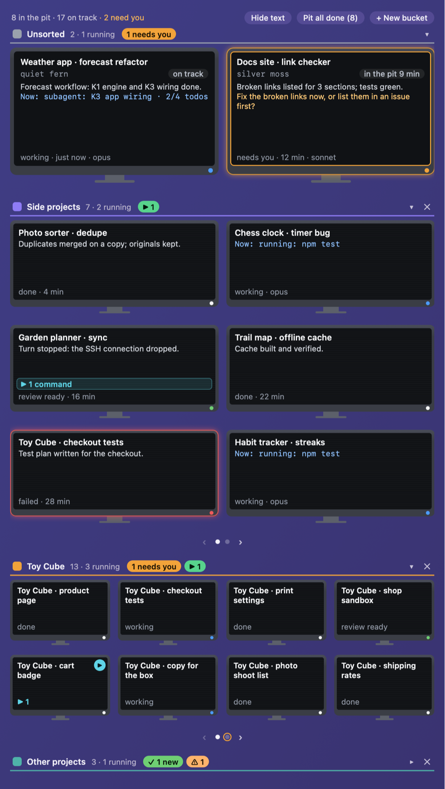
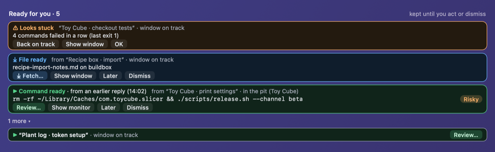
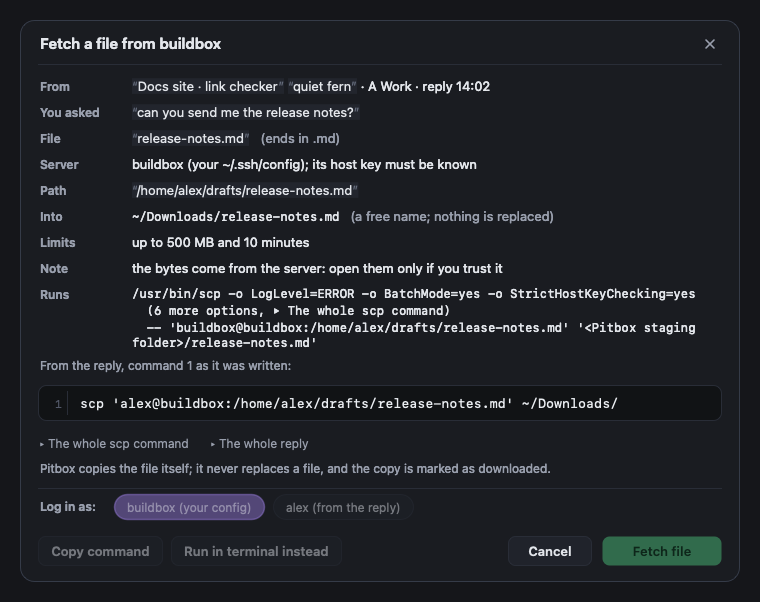
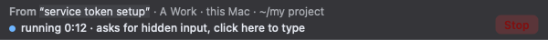

# Pitbox

Pitbox is a small macOS app for **Claude Code sessions in the Claude desktop app**. It sits at the edge of your screen
as a two-column strip and shows one monitor per session: what it is doing, whether it needs you, when it finished,
its ETA. You sort sessions into buckets, and a Ready list collects what waits for you: finished work, files and
commands a session handed you, warnings. A session's pop-out window can go **in the pit** (the window is minimized and
the session keeps running) and come **back on track** (restored at its old place and size) with one click, a drag
onto the strip or ⌃⌥P. Commands a session suggests open on a review sheet; Pitbox runs one only after you read it and
click, and that is off until you turn it on.



- **Status: early.** A personal project, maintained on a best-effort basis. Expect rough edges; there are no
  releases yet.
- Not affiliated with or endorsed by Anthropic. "Claude" is used only to say what Pitbox works with.
- Nothing leaves your Mac: no telemetry, no update check, no AI ([privacy](#privacy)).

## Requirements

- macOS 26 or newer.
- The Command Line Tools (`xcode-select --install`) or Xcode; Swift 6.2 or newer.
- The Claude desktop app with Claude Code sessions.
- A network connection for the first build only: SwiftPM fetches SwiftTerm and, because SwiftTerm's package lists it,
  swift-argument-parser (which is not built into the app; [THIRD_PARTY_NOTICES.md](THIRD_PARTY_NOTICES.md)).

There are no prebuilt downloads: an unsigned, un-notarized app downloaded from the internet would be blocked by
Gatekeeper on every update. You build Pitbox yourself.

## Build from source

1. **Install the tools** (once): `xcode-select --install`.
2. **Clone with git**, not as a ZIP:

   ```sh
   git clone https://github.com/drcollect/pitbox.git
   cd pitbox
   ```

   A ZIP downloaded with a browser is quarantined, and so may be what you unpack from it; macOS can then block the
   scripts or the app you build. A clone carries no quarantine flag, and an app you build on your own Mac opens
   without a Gatekeeper prompt.
3. **Create a signing identity** (once, recommended): `scripts/make-dev-cert.sh`.

   Why: macOS ties the Accessibility permission to the app's code signature. Without a stable identity every rebuild
   looks like a new app to macOS, so you would have to grant Accessibility again after each build.

   What it does, plainly: it creates a new private key and a **self-signed certificate** ("Pitbox Dev", valid 10
   years, usable for code signing only), imports both into your **login keychain** (only `/usr/bin/codesign` may use
   the key without asking), and marks the certificate as **trusted for code signing** for your user account on this Mac
   (`security add-trusted-cert -r trustRoot -p codeSign`; macOS asks for your login password). That means **anyone who
   holds this key could sign code that your account trusts for code signing.** The key is made on your Mac and goes straight into your
   login keychain (the script's temporary copy is deleted); it is never sent anywhere. The first time `codesign` uses
   it, macOS may ask whether codesign may use the key: choose Always Allow.

   To remove it again: `security delete-identity -c "Pitbox Dev"` (or delete the "Pitbox Dev" certificate and its key
   in Keychain Access). `scripts/build.sh` then signs ad hoc again. The trust setting for the deleted certificate may
   stay behind in your user's trust settings; it is harmless.

   If you cancel the password prompt (or the trust step fails), the identity is created but not trusted yet, and the
   script says so and exits with an error. Run it again: it finds the identity and repeats only the trust step (no
   second key is made). It picks the certificate by the identity's SHA-1 hash, among identities whose name is exactly
   "Pitbox Dev" (not ones that merely contain it), and if more than one identity has that name it stops without
   changing anything and lists their hashes: remove the extra ones in Keychain Access (or with `security
   delete-identity -Z <hash>`) and run it again. You can also set the certificate's Code Signing trust to Always Trust
   in Keychain Access yourself.

   If you prefer not to add a certificate, skip this step: `scripts/build.sh` then signs **ad hoc**. That works, but
   macOS forgets the Accessibility permission after every rebuild, and old entries pile up in the Accessibility list.
4. **Build:** `scripts/build.sh`. It builds the app and its command helper in release mode, assembles
   `build/Pitbox.app`, signs the helper and then the app (with "Pitbox Dev" when it exists), and checks the result with
   `codesign --verify --deep --strict`. It does not open or install anything. Optional environment variables:
   `PITBOX_SIGN_IDENTITY` (another identity, or `-` for ad hoc), `PITBOX_BUNDLE_ID` (your own bundle id for a fork; the
   default is `io.github.drcollect.pitbox`), `PITBOX_SCRATCH` (SwiftPM's build folder).
5. **Install:** move it to your Applications folder and open it there:

   ```sh
   mkdir -p ~/Applications && rm -rf ~/Applications/Pitbox.app && mv build/Pitbox.app ~/Applications/
   open ~/Applications/Pitbox.app
   ```

   Pitbox has no Dock icon; it lives in its strip and its menu bar item.
6. **Grant Accessibility** when asked: macOS shows its prompt, and Pitbox opens a short window that explains why, with
   a button for System Settings › Privacy & Security › Accessibility; turn Pitbox on there. Each feature starts as soon as the permission
   arrives; no restart is needed.

If the Accessibility entry gets stuck (for example after switching between ad hoc and "Pitbox Dev" signing), quit
Pitbox, reset it and grant it again:

```sh
tccutil reset Accessibility io.github.drcollect.pitbox
```

(Use your own `PITBOX_BUNDLE_ID` if you set one.) To update: `git pull`, `scripts/build.sh`, quit Pitbox from its
menu, and repeat step 5.

### What Accessibility is for

Pitbox uses the Accessibility permission for:

- sending Claude's pop-out windows into the pit and bringing them back on track;
- matching pop-out windows to their sessions by window title;
- drag-to-pit (dropping a window onto the strip) and desk tags;
- the **window guard**, which keeps other apps' windows from covering the strip.

For Claude's windows, Pitbox reads their titles, positions, sizes and minimized state. **The window guard works on
other apps' windows too:** it watches the windows of every regular app through Accessibility (created, moved,
resized), reads their position, size, kind (role and subrole), and minimized and full-screen state, and moves or
narrows a window that ends up over the strip. It leaves full-screen windows, minimized windows, floating panels,
windows while you drag them, apps without a Dock icon, Pitbox itself, some system parts (the Dock, Spotlight, Control
Center and others) and apps you exempt alone. It never reads other apps' window titles or contents, and nothing Pitbox
reads is what you type.

**One side effect to know about:** some apps (often Electron or Chromium apps) show windows but list none of them to
Accessibility. When such an app's window covers the strip, the guard asks that app once, by default, to build its
accessibility tree (it sets the app's `AXManualAccessibility` attribute) and looks again. The app may then use more CPU
and memory, and some apps change how they behave: VS Code, for example, may switch to its screen-reader mode. Pitbox
never turns the attribute off again; quitting the app resets it. To avoid it for an app, start Pitbox with that app
exempt, for example `open --env PITBOX_GUARD_EXEMPT=com.microsoft.VSCode ~/Applications/Pitbox.app` (a comma-separated
list of bundle ids; it lasts until Pitbox quits). Or pause the guard from the menu (Window guard: paused; it is on
again at the next launch). `PITBOX_GUARD_DRYRUN=1` makes the guard only log what it would do. See
[docs/SETTINGS.md](docs/SETTINGS.md#environment-variables).

Without the permission, the monitors and the Ready list still work from Claude's files, and each window feature says
"needs Accessibility". Pitbox asks for no other permission: no Screen Recording, no Automation, no microphone.

## Using it

- **Monitors** show each session's state in words (working, needs you, maybe needs you, review ready, done, failed,
  quiet, status unknown), its "Now" line, progress, and an ETA when the session stated one.
- **Buckets:** **+ New bucket**, then drag monitors between buckets. New sessions land in Unsorted.
- **In the pit and back on track:** click a monitor, press ⌃⌥P on a front pop-out window, or drag a pop-out onto
  the strip. "On track" means the window is on your desk; it says nothing about whether the session is working.
- **Fold:** the **−** in the header's corner (or ⌃⌥C, or the menu) folds Pitbox into a 24 pt rail with coloured dots for
  "needs you", "finished" and "running"; **+** brings it back. Folding stops nothing.
- **The menu bar item** has the rest: columns, edge, display, gaps, Hide text, Pit all done, All back on track (do this
  before you remove Pitbox), the window guard, docking, Settings…, Launch at Login, About.



## Privacy

Pitbox reads the Claude desktop app's private files on your Mac: the list of Claude Code sessions, the short summaries
Claude writes after each turn, the window list, and the ends of session transcripts. Transcripts contain what you
typed and what the session did, including file contents and command output, also for sessions running on a server
over SSH. To tell Claude's copies apart and match their windows, it also reads the running Claude processes' launch
arguments and, with the Accessibility permission, the titles and minimized state of Claude's windows. To keep the
strip free, the window guard also reads the position, size, kind and minimized and full-screen state of other apps'
windows (never their titles or contents) and moves those that cover the strip. For sessions on a server it reads your
`~/.ssh/config` (and, for a file fetch, the system's `/etc/ssh/ssh_config`) and asks `ssh -G` to resolve a host name,
which never connects, and only when every file could be read safely (no links, files that are yours or root's, no
`Match` block, no `Include` only ssh can expand, none on an external disk or a network share). It lists the program names on a fixed PATH to recognise
commands; it runs none of them. Pitbox reads all this only to show you status and to offer the commands and files a
session hands you. **Nothing leaves your Mac: no telemetry, no update check, no AI.** Links, previews, file fetches and
"Open a terminal on <host>" (an SSH connection) happen only when you click. These files are undocumented and can change
with any Claude update; Pitbox then shows "status unknown" rather than guessing.

Every file and call, and how each is read (no links followed, size limits, strict parsing):
[docs/THREAT_MODEL.md](docs/THREAT_MODEL.md). What Pitbox itself writes: [docs/ARCHITECTURE.md](docs/ARCHITECTURE.md).

**Logs** (`~/Library/Logs/Pitbox/pitbox.log` and the unified log) hold labels and numbers, and a few names: the window
guard's lines name the apps whose windows it looked at or moved, with window positions and sizes; the hotkey lines
name your shortcut text and keyboard layout; failures may include macOS's own error descriptions. They never hold
session text, commands, file paths, host names or window titles.

## Run

A session's reply often ends with a command for you. Pitbox offers the code blocks of the latest finished reply
(and, for up to 24 hours and two newer replies, those of earlier replies, behind an extra tick that says the session
has moved on since); clicking one opens a **review sheet** with the exact text, where it came from, which folder and
machine it is for, and every risk Pitbox recognises.



**Run is off by default.** The settings file says `"commands": "copyOnly"`: the sheet offers **Copy** and **Type into
terminal (don't run)**, which types the text into a fresh shell in Pitbox's console without pressing Return. Fetch file
(below) works either way. To allow Run, edit the settings file (menu bar item › Show the settings file) and set:

```json
"commands": "run"
```

It applies at once. The app never changes this key (it only writes the default `"copyOnly"` when it creates the
file); set it back to `"copyOnly"` to turn Run off again.

**What Run means.** A command a model wrote runs **with your rights** after your click: it can read and change your
files, use your network, read the Keychain items the `security` tool can read, and use your ssh-agent when it runs
`ssh`, `scp`, `git` and the like. The sheet shows every risk Pitbox recognises (deleting files, piping a download into a
shell, writing your startup files, printing a secret, and the other red lines in
[docs/SHELL_LANGUAGE.md](docs/SHELL_LANGUAGE.md)) and asks for a tick on each; it says plainly that **Pitbox cannot
tell what a program does**. One click runs the text you saw, once, in the folder shown.

What Pitbox does around it:

- The command runs in a clean `/bin/zsh` (no startup files, a fixed PATH, a short fixed list of environment
  variables), in a console tab at the bottom of the strip, and never takes your keyboard.
- It starts through a small helper as **its own app** for macOS privacy, so it never uses Pitbox's Accessibility
  permission, and macOS asks for any permission in the command's own name.
- A **sandbox** keeps the command out of Pitbox's own folder (`~/Library/Application Support/Pitbox`: settings,
  state and the dock socket), out of the sockets other apps keep under `~/Library/Application Support`, and out of
  folders you or a dock host name. Your other files, the Keychain, the
  ssh-agent and the network stay reachable on purpose.
- **The sandbox covers the command's own processes only.** A program the command hands to launchd (`launchctl`),
  `open`, `osascript` or another machine (including `ssh localhost`) runs **outside it**, with your rights.
- Setuid programs such as `sudo` cannot start in a command tab at all; use Copy and your own terminal.
- Nothing meant for another machine is ever run. For those, the sheet offers Copy and "Open a terminal on <host>".



**Fetch file.** When a session on a server hands you `scp server:file ~/Downloads/`, Pitbox can copy that one file
with its own fixed `scp` command (strict host keys, no forwarding, 500 MB and 10 minutes at most) into a private folder
and then into `~/Downloads` under a free name: it never replaces a file, and the file is marked as downloaded
(quarantined). Names that hide their type (`report.pdf.command`) are refused.

The details, and what is left over: [docs/THREAT_MODEL.md](docs/THREAT_MODEL.md) and [SECURITY.md](SECURITY.md).

### Private and old macOS parts

Pitbox depends on four things Apple does not offer as public, current API. Each is looked up at run time, and Pitbox
keeps working without it, with the stated loss:

- `_AXUIElementGetWindow`, a private Accessibility call that gives a window's number. Without it, windows are matched
  by their position and size at the same moment, or not at all.
- `responsibility_spawnattrs_setdisclaim`, a private spawn attribute that makes a command its own app for macOS
  privacy. Without it, Run and Type are off.
- `/usr/bin/sandbox-exec`, deprecated by Apple but present on macOS 26. Without it, Run and Type are off.
- `CGSSetConnectionProperty` (with `_CGSDefaultConnection`), a private window-server call that sets
  "SetsCursorInBackground", so the strip can show resize, text and link cursors while another app is active (Pitbox
  never activates itself). Without it the pointer stays the arrow over the strip.

A macOS update can remove or change any of them. The window guard also uses `AXManualAccessibility`, an attribute
Chromium-based apps understand but macOS does not document (see "What Accessibility is for").

## Troubleshooting

These all fail safe: Pitbox does less instead of guessing. Why they exist: [docs/THREAT_MODEL.md](docs/THREAT_MODEL.md),
T20, T33 and T36.

- **Host names show as unknown, Open a terminal is off, Fetch file says it couldn't read your SSH config without
  running it.** If your `~/.ssh/config`, a file it includes or a folder on their path (for example a `~/.ssh` linked
  into a dotfiles folder) is a link, is owned by someone else, is writable by group or others or is over 256 KB, or an
  `Include` uses `%` tokens, a `$` variable such as `${VAR}` or `~user`, or names a file on an external disk or a
  network share (`/Volumes/…`, `/net`, `/Network`, an automounted folder, also through a link or a wildcard), Pitbox
  treats the config as unreadable; it never looks there. Use plain files of your own and plain `Include` paths on this
  Mac's own disk.
- **A session working on an external disk or a network share** (`/Volumes/…`, `/net`, `/Network`, an automounted
  folder) shows as an unknown place, and Pitbox does not run its commands: Run and Type are off, and the sheet says
  "This session works on an external or network volume: Pitbox does not run its commands. Copy them instead." (also
  when the share was mounted there after the command was offered: the sheet checks again when it opens and at your
  click). Copy a command and run it in that folder yourself. The session gets no file results. (A session whose place Pitbox can't
  tell for another reason asks you to pick This Mac or The server; a command you run then starts in your home folder,
  which the sheet's Folder row names.)
- **With a network home folder** (`/home/<you>` through the automounter, as on some managed Macs) the home folder is
  refused too: Run and Type are off for every command, also those an SSH session hands to the Mac. Copy still works.
  An `Include` in your SSH config that names a file in it is refused as above.
- **In a console tab whose shell is in such a folder,** Cmd-click on a relative path does nothing.
- **An OSC 8 link whose text is a shortened or altered form of its address** (a query left out, `:443` shown, a path in
  other letter case) beeps instead of opening. Only the letter case of the scheme and host, a trailing `/` and `http`
  against `https` for `www.` text may differ. Text with spaces is weighed word by word: a word that reads as another
  address (`https://bank.example /login`, `visit https://a.example` for a link elsewhere) beeps too, and so does an
  address written with look-alike or fullwidth letters (`һttps://…` with a Cyrillic `һ`) or continued by a link at the
  start of the next line (`https://bank.example/` ending one line, a link showing `login` starting the next). Brackets,
  quotes and a trailing `.` or `,` around an address are left out, so `(https://…)` opens. Copy the address from the
  text instead.

## The optional ETA line

Pitbox shows an ETA when a session states one in its reply, and estimates one from the progress of background tasks
otherwise. You can ask Claude for a stated ETA by adding a line like this to your own Claude instructions (for example
`~/.claude/CLAUDE.md`):

```
If a task is likely to run for more than a few minutes, include a line "ETA: HH:MM" with the expected finish time
(24-hour clock, my local time) in your reply, and repeat the line with a new time if the estimate changes.
```

Pitbox reads `ETA:` followed by a time first, and a few other common forms. A time without a zone is your Mac's time
for local sessions; for sessions on a server it is read as UTC unless you set `serverTimeZones` for that server, so on
a server write the zone out (`"ETA: HH:MM UTC"`). Pitbox never edits your instructions, never asks a session for an
ETA, and works without one.

## Docking with a host app

Pitbox runs alone. Optionally it can dock beside another app's edge strip (a **dock host**) that speaks Pitbox's small
dock protocol: the two then read as one surface, and Pitbox follows the host's place, height, look and focus. Nothing
on the link can show session content or run, open or read anything. By default Pitbox listens on its dock socket
(`dock.enabled` is `true`) but refuses every app until you add its bundle id to `dock.hosts` in the settings file (for
example `"dock": {"enabled": true, "hosts": ["com.example.host"]}`). The menu's "Dock with …" tick (or
`"enabled": false`) turns docking off and closes the socket. The protocol, for anyone who wants to build a host:
[docs/DOCK_PROTOCOL.md](docs/DOCK_PROTOCOL.md).

## Settings

`~/Library/Application Support/Pitbox/settings.json`. The settings window (menu bar item › Settings…) changes the
harmless keys; the keys that change what runs or what is read are file-only. Every key: [docs/SETTINGS.md](docs/SETTINGS.md).

## Development

- Tests (Swift Testing; Command Line Tools are enough): `scripts/test.sh` builds once and runs each test target in its
  own process (the timing-sensitive suites would starve each other in one process). One target or suite:
  `scripts/test.sh --filter PitboxKitTests`. `scripts/test.sh` points Pitbox's state at a scratch folder, and the tests
  use invented sessions and files.
- `PITBOX_SCRATCH=<folder>` builds into another folder than `.build`.
- Before you open a pull request: `scripts/scrub-check.sh --generic-only` (no addresses, e-mail addresses or secrets in
  the repository).
- Where things are: [docs/ARCHITECTURE.md](docs/ARCHITECTURE.md). The shell language the command reader accepts:
  [docs/SHELL_LANGUAGE.md](docs/SHELL_LANGUAGE.md). How to contribute: [CONTRIBUTING.md](CONTRIBUTING.md).

## License

[Apache-2.0](LICENSE). Third-party code: [THIRD_PARTY_NOTICES.md](THIRD_PARTY_NOTICES.md).
